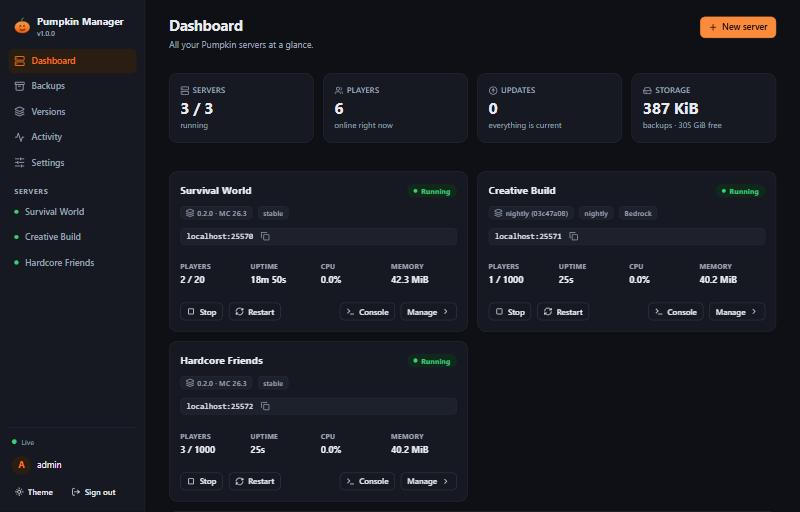

# Pumpkin Server Manager

A web dashboard in a single Docker container that **creates, runs, backs up and automatically updates
[Pumpkin](https://pumpkinmc.org) Minecraft servers** - built to be added to Unraid.

Pumpkin is a Minecraft server written in Rust. This manager downloads it from the official GitHub releases, sets up
as many servers as you like (each with its own port, world and settings), keeps them running, checks for new
Pumpkin versions on a schedule and **never applies an update without first making a verified backup**.

It also runs **Java servers**. [Vanilla, Paper and Fabric servers](#vanilla-paper-and-fabric-servers) are set up from what Mojang,
PaperMC and Fabric publish and kept up to date by the manager (the Minecraft version you pick, the newest stable build, the Java it
needs). For modded play, pick a modpack from [Modrinth](https://modrinth.com) or
[CurseForge](https://www.curseforge.com/minecraft/modpacks) and the manager downloads Java, the mods and the mod loader and
starts it. See [Modpack servers](#modpack-servers-java).



## Features

| | |
|---|---|
| **One-click servers** | Pick a name, a Pumpkin channel and a few settings; the manager downloads the binary, writes `pumpkin.toml`, assigns ports and starts it. |
| **Vanilla, Paper and Fabric servers** | Java servers without a modpack: Mojang's own server, Paper for plugins, or Fabric for mods (with Fabric API). The manager downloads the software (checksum-verified) and the Java it needs, offers newer builds, and switches to another Minecraft version with a backup first and an automatic rollback. |
| **Modpack servers** | Java servers from Modrinth and CurseForge modpacks (Fabric, Quilt, Forge, NeoForge): the right Java, every mod (checksum-verified), the loader and the pack's configuration are set up for you. Search from the dashboard, paste a link or upload a `.mrpack` or a CurseForge pack zip. CurseForge needs your own API key. |
| **Dashboard** | Live status, players, uptime, CPU and memory per server; live console with colours, command history and filter; start/stop/restart; file browser and editor with upload/download; player lists (whitelist, operators with individual levels, bans). |
| **Automatic updates** | Checks GitHub for new Pumpkin builds (stable releases, plus the rolling *nightly* and *canary* builds), per server: install automatically, notify only, or off. Waits until nobody is online. |
| **Safe by construction** | Download and checksum first, stop gracefully, **verified backup**, switch version, start, watch for crashes. If anything fails the version *and the world* roll back automatically. |
| **Backups** | Daily/interval schedule, retention, hot backups without downtime (or stop-copy-start), download/upload, protect, one-click restore with an automatic safety backup. |
| **Accounts for friends** | Give friends their own sign-in with a role per server (player, moderator or admin). They only see the servers you assign, start with a temporary password and must choose their own. See [Accounts for friends](#accounts-for-friends). |
| **Notifications** | Optional Discord/Slack/generic webhook for updates, failed backups and crashes. |
| **Unraid-ready** | PUID/PGID, template XML, graceful shutdown on array stop, separate backup path. No Docker socket needed, nothing runs privileged. |

## Contents

- [Install on Unraid](#install-on-unraid) · [Docker Compose](#docker-compose) · [First steps](#first-steps)
- [Ports and networking](#ports-and-networking) · [Configuration](#configuration)
- [How updates work](#how-updates-work) · [How backups work](#how-backups-work) · [Vanilla, Paper and Fabric](#vanilla-paper-and-fabric-servers) · [Modpack servers](#modpack-servers-java) · [Accounts for friends](#accounts-for-friends)
- [Security](#security) · [Where things are stored](#where-things-are-stored) · [Troubleshooting](#troubleshooting)
- [Pumpkin notes](#notes-about-pumpkin) · [Development](#development)

---

## Install on Unraid

Unraid needs the container image from somewhere. Both ways below end with the same template step. **A** works
immediately from the files in this repository; **B** sets up automatic builds on GitHub.

### A. Build the image on the Unraid server (fastest, nothing to set up)

Open the Unraid terminal (top-right `>_` icon) and run:

```bash
mkdir -p /mnt/user/appdata/pumpkin-manager-src && cd /mnt/user/appdata/pumpkin-manager-src
rm -rf PumpkinServerManager-main
wget -qO src.zip https://github.com/NiklaskoDev/PumpkinServerManager/archive/refs/heads/main.zip
unzip -q src.zip && cd PumpkinServerManager-main
docker build -t pumpkin-manager:local .
```

This takes a minute or two. Use the repository name `pumpkin-manager:local` in the template (see below). Unraid
cannot check a locally built image for updates; run the commands again when this project changes. (Pumpkin updates
are handled inside the dashboard and never need a new image.)

### B. Let GitHub build and publish the image (automatic)

1. **Get every file into the repository, including the hidden ones.** Dragging a folder into GitHub's web uploader
   *silently skips* names that start with a dot, which loses `.github/workflows/ci.yml` (the workflow that builds the
   image), `.gitignore`, `.dockerignore` and `.gitattributes`. Use git instead:

   ```bash
   # new, empty repository:
   git init -b main && git add -A && git commit -m "Pumpkin Server Manager"
   git remote add origin https://github.com/<you>/<repository>.git && git push -u origin main

   # repository that already has files from a web upload (keeps its history, adds what is missing):
   git init -b main && git remote add origin https://github.com/<you>/<repository>.git
   git fetch origin && git reset origin/main
   git add -A && git commit -m "Add the hidden files (CI workflow and friends)" && git push -u origin main
   ```
2. Open the repository's **Actions** tab. The *CI* run builds the image, starts it, signs in over HTTP and then
   publishes a multi-arch image (amd64 + arm64) to `ghcr.io/<you>/pumpkin-manager:latest`. The first run takes
   about ten minutes. (The unit tests run alongside; a red test job is worth a look but does not block the image.)
3. **Check that the package is public.** A package published from a public repository normally is. If Unraid
   still fails with `Head "https://ghcr.io/v2/.../manifests/latest": denied`, change it: GitHub → your profile →
   **Packages** → `pumpkin-manager` → *Package settings* → *Danger Zone* → **Change visibility** → Public.
   (Or keep it private and run `docker login ghcr.io` on the Unraid terminal with a personal access token that has
   `read:packages`.)

### Add the container in Unraid

1. Put the template on the flash drive (Unraid terminal):
   ```bash
   wget -qO /boot/config/plugins/dockerMan/templates-user/my-PumpkinManager.xml \
     https://raw.githubusercontent.com/NiklaskoDev/PumpkinServerManager/main/unraid/pumpkin-manager.xml
   ```
   (or copy `unraid/pumpkin-manager.xml` there by hand; from Windows the folder is
   `\\tower\flash\config\plugins\dockerMan\templates-user\`).
2. **Docker** → **Add Container** → *Template*: pick **my-PumpkinManager** from the *User templates* group. This is
   what fills in the ports, folders and variables: creating the container by typing only a repository name gives you a
   container with no ports and no persistent storage.
3. Using route A? Change **Repository** to `pumpkin-manager:local`. Using route B, leave it as is.
4. Review the settings below and click **Apply**.

### Settings to review in the template

| Setting | What to do |
|---|---|
| **AppData** `/data` | Servers, downloaded Pumpkin binaries and the settings database. A path on your cache pool is best. |
| **Backups** `/backups` | Put this on a **different disk** than AppData (for example an array share) so one failed drive cannot take both. |
| **Game ports** | Every server gets the next free port from this range. Keep host and container side identical, and equal to the *Port range* variables. Add more ports if you want more servers. |
| **Admin password** | Initial password for the user `admin` (min. 8 characters). Leave empty to have one generated; it is printed once in the container log. |
| **Time zone** | Used for "daily at 04:00" backups. |

Apply, then click the container's **WebUI** entry (port 8420). Port forwarding for friends: forward the **TCP**
port of each server from your router to the Unraid IP.

> Prefer the command line? This is equivalent:
> ```bash
> docker run -d --name pumpkin-manager --restart unless-stopped --stop-timeout 300 \
>   -p 8420:8420 -p 25565-25575:25565-25575/tcp -p 19132-19142:19132-19142/udp \
>   -e PUID=99 -e PGID=100 -e TZ=Europe/Berlin -e BACKUP_DIR=/backups -e ADMIN_PASSWORD='choose-a-password' \
>   -v /mnt/user/appdata/pumpkin-manager:/data -v /mnt/user/backups/pumpkin-manager:/backups \
>   ghcr.io/niklaskodev/pumpkin-manager:latest
> ```

## Docker Compose

```bash
docker compose up -d --build        # builds from this folder
docker compose logs pumpkin-manager # first start: shows the generated admin password if you did not set one
```

See [`docker-compose.yml`](docker-compose.yml) for the full example.

## First steps

1. Open `http://<server-ip>:8420` and sign in as `admin`.
2. **New server** → give it a name → *Create server*. The first creation downloads Pumpkin (about 120 MB); after
   that servers are created in seconds.
3. The card shows the address players use (`host:port`) with a copy button. In Minecraft: *Multiplayer → Add server*.
4. Open the server for the console, settings, files, players, backups and version tabs.

---

## Ports and networking

* **Dashboard**: TCP 8420 (`WEB_PORT`).
* **Java game ports**: the manager hands out one TCP port per server from `PORT_RANGE` (default `25565-25575`,
  so up to 11 servers). The same range is mapped 1:1 by the container, because Docker publishes exactly the ports
  you list.
* **Bedrock** (optional, experimental in Pumpkin): each Bedrock-enabled server needs **two** UDP ports from
  `BEDROCK_PORT_RANGE` (`19132-19142` = up to five servers). Pumpkin also tries a fixed UDP port 7551 for LAN
  discovery; only the first Bedrock server gets it and the others log a harmless warning.
* **Query** (optional): UDP on the server's Java port.
* **Management API ports** (`MGMT_PORT_RANGE`, default `29000-29999`) are used only on `127.0.0.1` inside the
  container and are never published.
* **Host networking** also works (`--network host`): no port mapping needed, but ports must be free on the host.
  The manager checks that a port is free before assigning it.
* The dashboard warns on a server whose port lies outside the published range.

## Configuration

Everything has a sensible default; the template sets the ones you usually want.

| Variable | Default | Purpose |
|---|---|---|
| `PUID` / `PGID` | `99` / `100` | User and group the manager and all servers run as (Unraid's *nobody:users*). Files stay accessible through your shares. |
| `UMASK` | `022` | File creation mask (`002` lets your group edit server files). |
| `TZ` | `UTC` | Time zone for schedules and timestamps. |
| `ADMIN_USER` / `ADMIN_PASSWORD` | `admin` / generated | Account created on the very first start. Change the password in *Settings* afterwards. |
| `DATA_DIR` | `/data` | Servers, binaries, logs and the database. |
| `BACKUP_DIR` | `$DATA_DIR/backups` | Backup folder (map it to a separate disk). |
| `PORT_RANGE` | `25565-25575` | Java ports available to servers. |
| `BEDROCK_PORT_RANGE` | `19132-19142` | UDP ports for Bedrock-enabled servers (two per server). |
| `MGMT_PORT_RANGE` | `29000-29999` | Loopback-only ports for the management API. Must not overlap `PORT_RANGE`. |
| `WEB_PORT` / `WEB_HOST` | `8420` / `0.0.0.0` | Where the dashboard listens. |
| `GITHUB_TOKEN` | - | Optional. Only needed if GitHub's anonymous rate limit (60 requests/hour) is hit. No scopes required. |
| `CURSEFORGE_API_KEY` | - | Optional. Only needed for CurseForge modpacks: **your own** API key from [console.curseforge.com](https://console.curseforge.com/) (see [CurseForge modpacks](#curseforge-modpacks)). It can be entered under *Settings → Modpacks* instead, which takes precedence. |
| `PUBLIC_ADDRESS` | - | Host name shown to players (for example a DynDNS name) and used in the sign-in address handed out with new friend accounts. Defaults to the address in your browser. Can also be set under *Settings*, which takes precedence. |
| `UPDATE_CHECK_MINUTES` | `360` | Initial check interval; changeable in the dashboard. |
| `SESSION_HOURS` | `168` | Sign-in lifetime. |
| `MAX_UPLOAD_MB` | `4096` | Largest file the file manager accepts. |
| `SHUTDOWN_TIMEOUT` | `240` | Seconds to wait for servers when the container stops. Keep it below Docker's own stop timeout (the template sets 300). A modded server with a big world needs minutes to save. |
| `COOKIE_SECURE` | `auto` | `auto`, `always` or `never` for the session cookie's *Secure* flag. |
| `FORWARDED_ALLOW_IPS` | `127.0.0.1` | Trusted reverse-proxy addresses (see [Security](#security)). |
| `PUMPKIN_REPO` | `Pumpkin-MC/Pumpkin` | GitHub repository releases are taken from. |
| `LOG_LEVEL` | `INFO` | Manager log verbosity. |

---

## How updates work

This is about Pumpkin servers. A modpack server has its own, similar procedure, described under
[Modpack servers](#modpack-servers-java).

**Channels.** Each server follows one channel:

* **Stable**: tagged releases such as `0.2.0+26.3-26.51` (Pumpkin version + Minecraft version). Recommended.
* **Nightly** and **Canary**: *rolling* prereleases. Their tag never changes - the binary behind it is replaced.
  The manager therefore identifies builds by the **SHA-256 digest GitHub reports**, not by the tag, and keeps the
  previous binary on disk (GitHub no longer serves it once it was replaced) so a rollback is always possible.

**Checks.** Every `UPDATE_CHECK_MINUTES` (and on demand with *Check for updates*) the manager asks GitHub which
build each channel offers. Requests are conditional (ETag), so most checks cost nothing against the rate limit.

**Per-server policy** (Version tab): *install automatically*, *notify only*, or *off*. A server can also be
**pinned** to one release. Automatic installs wait until nobody is online (up to a configurable number of hours;
after that players get an in-game warning first). Switching a server to another *channel* is never automatic.

**The update procedure** - the order is the safety guarantee:

1. Download the new binary and verify its SHA-256 - **while the server keeps running** (no downtime for slow downloads).
2. Warn online players, then stop the server gracefully (the world is saved).
3. Create a **verified backup** (full archive read-back plus checksum). **If this fails the update is aborted**,
   nothing is changed and the server is started again on the old version.
4. Switch to the new binary and start the server.
5. Wait for it to accept connections and watch it for 15 seconds.
6. If it fails to start or crashes: stop it, **restore the world from the backup taken in step 3**, switch back to the
   old binary and start that. The failed build is remembered and not retried; a newer build is.

Two failure modes happen before anything is stopped, and the server keeps running through both: a download that is
**unusable** (not a Linux executable, or the wrong checksum) is refused and that exact build is skipped from then on,
while a **temporary** problem (network, disk space) is retried automatically with a growing delay: 30 minutes, then
60, 120, ... up to 12 hours between attempts, starting over after the next success.

Every step is visible in the job log, in *Activity* and (optionally) as a webhook message. Afterwards the **Version
tab** keeps a history and a **Roll back** button (version only, or version *and* the pre-update world).

**Disk space.** Downloaded binaries are shared by all servers (`/data/binaries`). A build that a server runs, can roll
back to or is about to update to is never removed. After every update the manager deletes older builds nobody needs,
but keeps the newest build of each channel as a spare (*Settings → Builds to keep as spares*, one by default).
*Versions → Clean up unused* deletes every build that no server needs, spares included. A deleted build is downloaded
again when it is needed, except a rolling-channel build that GitHub has already replaced.

What this does *not* protect against: a bug in a new version that only shows up hours later, or world damage that
you notice after playing for a while. That is what the pre-update backup and the Roll back button are for.

## How backups work

* **Schedule**: daily at a time you choose, or every N hours, per server. **Retention**: keep the newest N;
  backups you **protect**, and the one belonging to your latest update, are never deleted automatically.
* **Hot backups** (default) don't stop the server: the manager flushes the world (`save-all flush`), pauses
  autosaving (`save-off`), copies the files, then resumes (`save-on`, always, even on errors). If the management API
  is available it is used for the flush. This is "crash-consistent at worst". Choose **cold** in the Backups tab to
  stop the server, copy and restart for a perfect copy. Backups before updates/restores/deletion are always cold.
* **Format**: `.tar.gz` with a small manifest. Each backup is read back and checksum-verified before it counts.
* **Restore**: stops the server, makes a *safety backup* of the current state, extracts the archive into a temporary
  folder and only then swaps it in, so a failed restore never damages what you have. Network settings (ports,
  management secret) stay the manager's.
* **Download / upload**: move backups to another machine or restore an archive from elsewhere.
* A backup needs free space about the size of the world; the manager checks first and says so if there is not enough.

## Vanilla, Paper and Fabric servers

*New server → Vanilla, Paper or Fabric server* sets up a Java server without a modpack, from what its maker publishes:

* **Paper** (the recommended one): fast, runs plugins (the Bukkit and Spigot ones) and fixes many problems of the vanilla server.
  The jar comes from PaperMC's download service.
* **Vanilla**: Mojang's own `server.jar`, exactly as it ships. No plugins and no mods.
* **Fabric**: a light mod loader. The manager installs Fabric's server launcher and, unless you turn it off, **Fabric API**, which
  nearly every Fabric mod needs (from Modrinth, for the right Minecraft version).

Pick the software, a **Minecraft version** (the newest release that has a stable build is suggested; snapshots can be shown for Vanilla
and Fabric), and optionally a specific Paper build or Fabric loader version. The manager downloads the file and checks it against
the checksum its maker published with it (SHA-1 from Mojang, SHA-256 from PaperMC; Fabric's launcher has none, so it is checked to be
a jar), installs the **Java** that Minecraft version needs the same way as for modpacks (see *Which Java and why* below), writes
`server.properties` and `eula.txt` and starts the server. Memory starts at 2 GiB (a few friends are fine with that; more players,
bigger worlds or many plugins want more), and Paper servers start with the Java options PaperMC recommends for the version (a switch
in the dialog; they show under *Settings → Java* and can be changed there). Console, players, files, backups and accounts for friends
work as for every other server.

* **Builds.** Paper marks each build *stable*, *beta* or *alpha*, and advises against running the experimental ones on a server that
  matters, so the manager only installs and offers stable builds unless you choose an experimental one on purpose. A brand new
  Minecraft version often has none yet; then the dialog says so and the newest stable version stays the suggestion.
* **Plugins and mods.** Upload them in the *Files* tab: Paper's go into `plugins/`, Fabric's into `mods/`. The manager does not manage
  them (it does not update them), except for Fabric API, which it installs and keeps matching the Minecraft version.
* **Updates, two kinds.** A newer **build** of the Minecraft version the server runs (a Paper build, a Fabric loader version) shows
  as *Update available* in the *Version* tab and on the dashboard. A Paper server installs those by itself by default, waiting until
  nobody is online, like Pumpkin updates (*install automatically*, *notify only* or *off*, per server; Fabric and Vanilla servers
  start on *notify*). A newer **Minecraft version** is different: it converts the world and breaks plugins and mods until their makers
  catch up. The *Version* tab tells you when one is out, and you switch to it yourself. For Vanilla, a newer release is the update
  and is never installed without you either.
* **The update procedure** is the one of every other server: the new file is downloaded while the server keeps running, then the
  server is stopped, a **verified backup** is made, the file is switched, the server starts and is watched, and if it does not
  come up the backup is restored automatically. *Roll back* restores the backup made before the last update.
* **Switching version.** *Version → Switch to another version* installs any version the software offers. Going to a newer Minecraft
  version warns that the world is converted and that the old version cannot open it again (the backup made first is the way back);
  going to an *older* one has to be confirmed, because a world that a newer version opened usually cannot be opened by an older one. The
  right Java is installed if the other version needs another. Fabric API follows the Minecraft version; one you replaced by hand is
  left alone, and a version Fabric API does not exist for yet is refused before anything changes. Paper no longer builds old versions
  (and says when it stopped maintaining one): those still run, but get no more fixes.
* **Backups** leave out what the software unpacks or downloads again by itself when it starts: `cache/`, `libraries/`, `versions/`
  and, for Fabric, `.fabric/` at the top of the server folder. A fresh server is mostly that, so a backup is far smaller (a new Vanilla
  server: 108 → 54 MiB, Paper: 169 → 77 MiB, Fabric: 134 → 3 MiB), and the world, `plugins/`, `mods/` and the configuration are always in.
  After a restore (or a rolled back update) Paper and Fabric fetch those files from their makers again on the next start, as they did
  on their first one, so the container needs internet access then; Vanilla unpacks them from its own jar. The patterns are part of
  the server's backup settings.
* **A deleted jar comes back.** If the server's jar is missing when it starts (deleted by accident, or lost in a restore), the
  manager downloads exactly the build the server runs again.
* **Run for real.** Vanilla, Paper and Fabric servers were created, started, pinged, given commands, backed up, restored and stopped
  with the real services (Minecraft 26.3 on Java 25); each was updated one build (Vanilla: one release) forward and rolled back; and
  each was switched from 1.21.11 (Java 21) to 26.3 (Java 25), converting its world, with Fabric API replaced and restored by the
  rollback. `scripts/real_java_check.py --accept-eula --software all` (add `--software-update` or `--software-from 1.21.11`) repeats
  that on your own setup.

## Modpack servers (Java)

Besides Pumpkin servers the manager runs **modded Java servers from Modrinth and CurseForge modpacks**. Choose *New server →
Modpack server*, search Modrinth or CurseForge (or paste a modpack link, or upload a `.mrpack` or CurseForge zip), pick a
version, set the memory, accept the [Minecraft EULA](https://aka.ms/MinecraftEULA) and create. (CurseForge needs an API key
of your own, see [CurseForge modpacks](#curseforge-modpacks).) The manager then

1. reads the pack and downloads the **Java** its Minecraft version needs (Eclipse Temurin: Java 8, 17, 21 or 25, chosen
   from Mojang's own data and installed in `/data/java`, so it is not part of the image; Java 8 is pinned to 8u312, see
   *Which Java and why*);
2. downloads every mod, checked against the checksums in the pack (the Modrinth format only allows Modrinth, GitHub and GitLab
   as sources; for CurseForge packs the checksums come from CurseForge's API), and puts the pack's configuration in place;
3. installs the **mod loader** (Fabric, Quilt, Forge or NeoForge) with its official installer;
4. writes `server.properties` and `eula.txt` and starts the server.

Console, players (whitelist, operators with individual levels, bans), files, backups and accounts for friends work as for
Pumpkin servers. What is different:

* **Memory.** A modpack server needs gigabytes (most packs 4-8 GiB), where a Pumpkin server needs next to nothing. The
  dashboard shows how much the machine has. The memory and extra Java options are settings of the server that only the
  administrator can change (*Settings → Java*).
* **The first start is slow.** The world is generated and the mods load; a big pack takes several minutes. The startup
  timeout is 15 minutes by default (*Settings → Startup timeout*) and the stop timeout 3 minutes. Saving a big world
  can take that long when the container stops, so the template gives the container 300 seconds (`--stop-timeout 300`,
  *Extra Parameters*): raise it in a container you created from an older template, or Docker ends the servers early.
* **Backups** copy the server only after it said that the world is saved (`save-off`, `save-all flush`, then "Saved the
  game"), and leave out `logs/` and `crash-reports/`. Mods and configuration are included, so a restore brings back the
  whole server. Backup size is mostly the mods plus the world.
* **Files.** Mods live in `mods/`, their configuration in `config/` (and folders like `kubejs/`). Change them in the
  *Files* tab and restart. Game settings are in *Settings*, which edits `server.properties`.
* **Extra ports.** Some mods open their own port (voice chat on UDP 24454, a web map, ...). Add those to the container's
  port mappings yourself; the manager only manages the game port.
* **Updating the modpack.** The *Modpack* tab asks Modrinth or CurseForge for newer versions (on the same schedule as the Pumpkin update
  check, or with *Check now*) and tells you, but never installs one by itself. *Update now* works like a Pumpkin update: the
  new version and its mods are downloaded while the server keeps running, then the server is stopped, a **verified backup**
  is made, the mods and configuration are switched, and the server starts again and is watched; if it does not come up, the
  backup is restored automatically. Mods the new version dropped are removed. **Whatever you changed by hand is kept**: a
  configuration file you edited stays as it is, with the modpack's new version saved beside it as `<name>.pack-new`, and
  `server.properties` is never replaced. If an update moves to another Minecraft version (or loader), the dashboard warns
  first, and the right Java and loader are installed. *Roll back* restores the backup made before the last update, mods
  and world included. Servers made from a Modrinth or CurseForge pack only; a server made from an uploaded file has no place to
  look for updates.
* **Client-only mods are left out.** Packs made for players often list minimaps, menus and shader helpers for the server too
  (in the popular packs it is dozens of mods), and many of those stop a server from starting. The manager asks Modrinth, which
  knows for every mod whether it can run on a server, and does not install the ones that cannot. They are listed under
  *Modpack → Left out*, updates treat them the same way, and a switch in the *New modpack server* dialog turns this off. A mod
  that another mod of the pack needs stays, and mods the pack carries inside its own folders are checked too. What Modrinth
  cannot tell (a mod it does not know, or one that is wrongly marked) still shows up as a failed start, with the loader's own
  message; see *Troubleshooting*. **Packs made as a player's collection are the usual case**: expect to remove a mod or two by
  hand from the biggest ones, while packs that were prepared for servers (Cobblemon, for one) start without any help.
* **Packs with the Missing Mods Checker (Better MC).** Mods that are only on CurseForge cannot be part of a Modrinth pack, so Better
  MC and a few others ship the *Missing Mods Checker* mod and a list of them (`config/missing_mods_checker.json`): when the game
  starts, a window helps the player download what is missing. A server has no screen, so that mod ends it with *"No X11 DISPLAY
  variable was set"*. The manager does the window's job instead: it installs the listed mods through CurseForge's API (this needs
  your [CurseForge API key](#curseforge-modpacks); each file is checked by the checksum CurseForge gives), lists the ones it cannot
  install under *Modpack → Mods to add yourself* (no key, or the author does not allow downloads), and leaves the mod's list off the
  server so that the mod finds nothing to ask about. Java servers also start with `-Djava.awt.headless=true`.
* **Some packs finish their setup on the first start.** Better MC, for one, downloads further mods when it starts for the first
  time and then ends the server on purpose (exit code 0). The manager starts such a server once more by itself; if it still
  does not come up, the message says what the server last wrote.
* **A server that cannot start is stopped at once.** Forge and NeoForge print *Failed to start the minecraft server* and can
  then keep running without doing anything; the manager acts on that line, stops the server after a short grace period, and
  shows the reason instead of waiting for the startup timeout.
* **Which Java and why.** Minecraft 1.20.5 and newer need Java 21, 1.18-1.20.4 need Java 17, older versions Java 8, and the
  year-based versions (26.x) Java 25. The manager takes this from Mojang's metadata and keeps the runtime a server uses.
  *Versions → Java runtimes* lists what is installed and removes what no server needs. On arm64 only Java 21 and 25 exist for
  Alpine, so older modpacks cannot run there.
* **Java 8 stays on 8u312** (October 2021) instead of following the newest build, so that old modpacks work: Forge for
  Minecraft 1.16.5 up to 36.2.25 (Create: Above and Beyond, for one) cannot start on the Java 8 security update of January 2022 or
  anything newer, and everything older (1.7.10, 1.12.2, ...) runs on 8u312 just as well. Temurin never built 8u312 for Alpine,
  so the container takes the same version from Azul (Zulu); Windows and other Linux systems get Temurin's. Servers on Java 8
  that were set up before this switched to it the next time one starts and no other Java 8 server is running; if the download
  fails they keep the Java they had. The price is a Java 8 without the security fixes released since then, which matters little
  for a game server that only friends can reach.
* **The image is Alpine Linux** (musl). Almost every mod works; the few that ship native libraries built only for the
  common Linux (glibc) may fail to load, which then shows in the console.

* **Run for real.** Servers on Fabric, NeoForge, Forge and Quilt, and the Modrinth packs Cobblemon (installed, updated to the next
  version, rolled back) and Better MC (installed, backed up, restored, and an update that could not start was rolled back by
  itself), have been run on Windows and in this image on Linux, with the real Java, Minecraft server and mods;
  `scripts/real_java_check.py` repeats that whenever you want to see it for your own setup. CurseForge packs have been run
  on Windows with a real CurseForge key: Cobblemon Official Modpack [Fabric] (from the author's server files and from the
  list of mods; created, started, backed up, restored, updated from 1.8 to 1.8.1 and rolled back), All the Mods 10 (461 mods from
  the author's server files: started, backed up, restored, updated from 8.1 to 8.2 and rolled back), Prominence II (its server files hold no mods, so
  the list of mods was used: 347 mods installed, 5 left to add by hand) and Better MC [FABRIC] BMC2 (the 22 mods its Missing
  Mods Checker asks for installed through CurseForge, then every check). The Linux image has not run CurseForge packs yet: the key
  cannot go into the CI.

> **Mods are code.** Every mod runs with the container's access, like Pumpkin plugins would. Only install packs you trust,
> and give the Admin role of a modpack server only to people you trust (see [Accounts for friends](#accounts-for-friends)).

### CurseForge modpacks

CurseForge hands its modpacks out through an API that needs **an API key of your own**. Ask for one at
[console.curseforge.com](https://console.curseforge.com/) (the key starts with `$2a$10$`; the *upload token* that the same site
shows is something else and does not work), then paste it under *Settings → Modpacks* (or set `CURSEFORGE_API_KEY`). The manager
checks it with CurseForge right away. A new key can take a few minutes before it is accepted. CurseForge's terms make a key
personal and not to be shared, so the manager ships none: yours is kept in the manager's database, shown nowhere and sent only
to CurseForge's own servers: its API, and its download servers, which ask for it so that the download is counted for the mod's
author. It is not passed on to Minecraft, to the mod loader installers or to any other address (a download that is redirected
anywhere else is refused).

Then *New server → Modpack server → CurseForge* works like the Modrinth tab: search, or enter a pack's **project number** (the
*Project ID* in the box on its CurseForge page) or a link to its page, choose a version and create. The zip from the pack
page's *Download* button can be uploaded too. If a key cannot use CurseForge's search, the dialog lists the packs CurseForge
itself features and takes a project number instead. What differs from Modrinth packs:

* **The author's server files are used when a version has them.** Most big packs come with a ready server pack: the mods and
  configuration their author tested together. The manager takes its mods, configuration and scripts (the pack's start scripts,
  loader installer, `user_jvm_args.txt`, player lists and `eula.txt` are not taken over: the manager installs the loader,
  sets the memory and writes the EULA itself), so nothing is downloaded mod by mod and nothing is "left out": the author's
  choice is not second-guessed. A switch in the dialog installs from the pack's list of mods instead.
* **Without server files the pack's list of mods is used.** A CurseForge pack lists only project and file numbers, so the manager
  asks CurseForge for their addresses and checksums, downloads every mod and checks it against the checksum CurseForge gave
  (only CurseForge's own download hosts are used). Mods that only work on a client are left out as for Modrinth packs: by
  CurseForge's own *Client* tag and by the lookup at Modrinth, with the same rule that a mod another mod needs stays.
* **Mods that their authors do not let programs download.** Some authors switch automatic downloads off. The manager does not
  work around that (no scraping of CurseForge's website): it lists those mods under *Modpack → Mods to add yourself*, each with
  a link to its page, creates the server without them and does **not start it**. Download them yourself, put the files into
  `mods/` (Files tab) and start the server. An update that needs further such mods waits until they are there.
* **Nothing from CurseForge is cached.** Its terms ask for no copies of what the API hands out. Mods are only held in a temporary
  folder while an install or update runs (and wiped when the manager starts), and no answer of the API is stored, so a second
  server from the same pack downloads its mods again. A server of course keeps its own files.
* **Updates** work as for Modrinth (backup first, switch, start, watch, roll back by itself). A server made from server files is
  updated from the next version's server files: a mod you replaced stays, a configuration file you changed stays with the
  pack's new version beside it as `<name>.pack-new`, and `server.properties` is never replaced. A version that does not come
  the way the server was installed (server files against list of mods) is refused instead of guessed at.

## Accounts for friends

The account created on the first start is the **administrator**: it can do everything, including creating and deleting
servers, changing the global settings and managing accounts. Under **Accounts** the administrator can give friends their
own sign-in. A friend **only sees the servers assigned to them**, and what they may do there depends on the role they
have *on that server* (a friend can be an Admin on one server and only a Player on another):

| | Player | Moderator | Admin |
|---|:---:|:---:|:---:|
| See the server's status: running or not, who is online, CPU, memory, how to connect | yes | yes | yes |
| Start the server | | yes | yes |
| Read the console (live output) | | yes | yes |
| Kick, ban and pardon players and IPs, manage the whitelist | | yes | yes |
| Stop, restart or kill the server | | | yes |
| Type console commands | | | yes |
| Make or remove operators and set their level | | | yes |
| Files, settings, backups, versions and updates | | | yes |
| **Delete the server**, create servers, global settings, accounts | | | |

The last row stays with the administrator only.

**Temporary passwords.** Creating an account generates a temporary password and shows it **once** (the manager only keeps a
hash, so it cannot show it again; if it gets lost, use *New password*). Hand it over, together with the address of the
dashboard. When the friend signs in with it they see nothing but a *Choose a new password* screen; no other part of the
dashboard or API works until they have chosen their own (at least 8 characters, different from the temporary one, not
their username). *New password* in the accounts list gives an account a fresh temporary password and signs it out
everywhere; deleting an account ends its sessions at once. A friend's password can also be reset from the container with
`python -m pumpkin_manager reset-password --user <name>`, which makes it temporary as well.

The sign-in address shown with a new temporary password is the address you are using, with the host replaced by your public address (`PUBLIC_ADDRESS` or *Settings → Public address*), so friends get a name that works from outside. Friends outside your home network need a way to reach the dashboard: use a
VPN or an HTTPS reverse proxy as described under [Security](#security), not a plain port forward of the dashboard port.

What an account may do is enforced by the server on every request, and the live updates pushed to the browser are
filtered the same way, so a friend's browser never even receives events about other servers. A server the account has
no role on answers exactly like one that does not exist. Role changes take effect on the next request.

> **Give the Admin role only to people you trust.** Admins can edit the server's files, upload things and run console
> commands, and all servers run inside this one container under the same user: Pumpkin plugins, mods or other files an admin
> adds run with the container's access to every server's data and to the manager. Moderators and players cannot do any of that.
> (On a modpack server mods are Java code, so this is not a theoretical risk there. The memory and Java options of a server
> are for the administrator alone.)

## Security

* Sign-in with a password (scrypt-hashed), server-side sessions in `HttpOnly`, `SameSite=Strict` cookies,
  a CSRF token on every state-changing request, rate-limited login attempts and a strict Content-Security-Policy.
  The WebSocket verifies the browser's `Origin`.
* Browsers share cookies between ports of the same host name, so other web apps on your Unraid host *could*
  see (not forge) this one's cookie; the cookie is therefore named uniquely and requests need the CSRF header.
* The manager needs **no Docker socket** and no privileges; servers run as `PUID:PGID` with a minimal environment
  (your `ADMIN_PASSWORD`, `GITHUB_TOKEN` and `CURSEFORGE_API_KEY` are not passed on to Minecraft processes, mod loader
  installers or the Java checks).
* The management API of each server listens on loopback only and uses a per-server random secret.
* **Do not expose the dashboard directly to the internet.** The dashboard can run console commands and edit files.
  If you need remote access, put it behind a reverse proxy with HTTPS (and set `FORWARDED_ALLOW_IPS` to the proxy's
  address) or use a VPN such as WireGuard.
* Forgot the password? In the container console (Unraid: container icon → *Console*):
  `python -m pumpkin_manager reset-password`. It signs every session out.

## Where things are stored

```
/data
├── manager.db                    settings, users, server records, history (SQLite)
├── servers/<id>/                 one folder per server: pumpkin.toml, world/, data/ (whitelist, ops and ban lists), ...
│                                 (a modpack server has server.properties, mods/, config/, world/, ... instead)
├── binaries/<build>/pumpkin      downloaded Pumpkin binaries, shared by all servers
├── java/<major>/                 Java runtimes for modpack servers, downloaded when needed
├── cache/mods/                   mod files downloaded for Modrinth packs, kept once by checksum
│                                 (CurseForge files only live in cache/mods/curseforge-staging while an install runs)
├── cache/uploads/                pack files you uploaded (or that are being installed), until the server was created
└── logs/<id>/console.log         console output of the last run (+ console.prev.log)
/backups/<id>/<date>_<kind>.tar.gz
```

Editing `pumpkin.toml`: the settings form, the *Advanced* editor and the file manager all validate the file before
saving. This matters because **Pumpkin silently falls back to default settings when it cannot read its config**.
A few keys (ports, the management secret, console mode) belong to the manager and are re-applied before each start.

## Troubleshooting

| Symptom | Fix |
|---|---|
| `docker: ... ghcr.io/v2/.../manifests/latest: denied` | GHCR answers *denied* both when the image does not exist yet and when it is private. Check the repository's **Actions** tab for a green *CI* run (no run at all usually means `.github/workflows/ci.yml` never reached GitHub, see *Install* route B), then check that the package is public. Or skip GHCR: use route A. |
| *"Port 25565 is already in use by another program"* | Another container (or the host) uses it. Choose another port in the server's settings, or remove the other service. |
| Friends cannot connect | Forward the server's **TCP** port on your router to the Unraid IP. The card on the dashboard shows the exact port and warns when it is not published by the container. |
| *"No free port left in 25565-25575"* | Widen `PORT_RANGE` **and** the template's port mapping (they must match). |
| Update check says *rate limit* | Add a `GITHUB_TOKEN` (Settings or environment variable). |
| *"CurseForge did not accept the API key"* | It has to be the API key of console.curseforge.com (starts with `$2a$10$`), not the upload token, copied completely. A key that was just created may need a few minutes. |
| *"CurseForge does not let this API key search by name"* | Some keys may not use CurseForge's search. Pick a pack from the list, or enter its project number (the *Project ID* on its CurseForge page). |
| A CurseForge server was created but is not running, and *Modpack* lists *Mods to add yourself* | Those mods' authors do not allow downloads by other programs. Open each mod's page from the list, download the file, upload it into `mods/` (Files tab) and start the server. |
| Server stops right after starting | Open the console tab for the output. After editing `pumpkin.toml` by hand, use the Advanced editor, which validates it. |
| A Paper or Fabric server says *"Paper's download service could not be reached"* (or Fabric's, or Mojang's) when it is created, checked or updated | The container needs internet access to `fill.papermc.io`, `meta.fabricmc.net`, `piston-meta.mojang.com` and `api.modrinth.com` (and the hosts they send files from). The *Version* tab and the new-server dialog show the reason; nothing is changed by a failed lookup. |
| A Paper or Fabric update was rolled back by itself | The new build did not start, so the backup made before it was restored; the history in the *Version* tab says why, and that exact build is not offered again (the next one is). Nothing was lost. |
| The Version tab says *"Minecraft X is older than ..."* | Switching to an older Minecraft version has to be confirmed: a world that a newer version has opened usually cannot be opened by an older one. Restore from a backup made with that version, or keep the newer one. |
| *"Paper has no builds for Minecraft X"* / *"Fabric does not support Minecraft X"* | PaperMC builds Paper for Minecraft 1.7.10 and newer only, and Fabric supports 1.14 and newer; the version list shows what exists. A version with only experimental builds can be chosen on purpose under *Choose a specific build → Include experimental builds*. |
| Adding a player to the whitelist, operators or bans changes nothing | Those buttons type the command into the running server's console, and the Players tab shows what the server then wrote to its `data/` folder. The dashboard tells you when a list did not change; the console tab has the server's answer (for example *No player was found* when an account name does not exist and online mode is on). The server must be running. |
| Operators have too few (or too many) rights | New servers give operators **level 1** (moderator: can build inside the spawn protection, almost no commands); levels work as in vanilla (2 game master, 3 admin, 4 owner). Set the default for future operators under *Settings → Operator permission level*, and a single operator's level in the *Players* tab. Pumpkin reads levels only at startup, so changing one on a **running** server restarts it (the dashboard asks first); on a stopped server nothing restarts. Servers created before this default keep their old setting (4) until you change it, and so do operators who already exist. |
| The difficulty is not the one I chose | Pumpkin ignores `default_difficulty` in `pumpkin.toml`, so the manager sets it with the `/difficulty` command when a server starts for the first time and whenever you change it in *Settings* (a running server switches at once). A difficulty an operator sets in-game stays until you change the setting here. |
| The *Management API* shows "not available" | Normal for stable Pumpkin 0.2.0, which does not have it yet. The manager then uses console commands and server pings. |
| A friend forgot their password, or cannot sign in | Open *Accounts* and use *New password* for them: they get a new temporary password and choose their own again. After a few wrong attempts a name is locked out for a few minutes. |
| A friend sees "No servers yet" or is missing a server | Servers have to be assigned per account: *Accounts → Access*. The change shows up in their browser without a reload. |
| A modpack server stops while starting, or says it *did not become ready* | Open the console tab: `OutOfMemoryError` means the memory is too small (*Settings → Java*), a mod that complains names itself in the log, and a big modpack may simply need more than the startup timeout (*Settings → Startup timeout*). |
| A modpack server says *"The server reported that it could not start"* and names a mod (*"X has failed to load correctly"* with `net/minecraft/client/...`, or *"Mod A requires B ... B is not installed"*) | The pack was made for players and lists a mod for the server that only works on a client (or one that the manager left out is needed after all). The message is the loader's own: open the *Files* tab and delete the named jar from `mods/` for the first kind, or find the jar of the second kind (*Modpack → Left out* lists what was skipped; the modpack's page has the file) and upload it to `mods/`, then start again. Packs with a proper server version (a *server pack*) are the other way out. |
| A modpack server ends with *"No X11 DISPLAY variable was set"* (`HeadlessException`) | A mod wants to open a window, and a server has no screen. The lines before the error name the mod. Better MC's *Missing Mods Checker* is handled by the manager (see *Packs with the Missing Mods Checker* above): if you still see it, put the mods it lists into `mods/` and delete `config/missing_mods_checker.json` in the *Files* tab. |
| A Forge 1.16.5 modpack ends right away with `NoSuchMethodError: ... ManifestEntryVerifier` | The pack is built on a Forge for Minecraft 1.16.5 older than 36.2.26, which cannot run on a Java 8 newer than 8u312. The manager runs Java 8 servers on 8u312, so the server must have ended up on another Java 8 (the pinned build could not be downloaded: the container log says why, and a Java 8 server picks it up on its next start). Otherwise use a version of the pack that is built on Forge 36.2.26 or newer. |
| A modpack update was rolled back by itself | The new version did not start, so the backup made before it was restored; the update's history entry says why (the same loader message as above). Nothing was lost. |
| *"Could not download Java ..."* or a runtime that does not start | The container needs internet access to Adoptium (and Azul, for Java 8 on Alpine). In the container console, `python -m pumpkin_manager java-install 21` tries it and prints the reason. |
| A mod does not load and the log mentions a native library | The image uses Alpine Linux (musl); a few mods bring native code for glibc only. Look for a variant of that mod without native code, or report it to the mod's author. |
| Backups fill the disk | Lower *Keep the newest*, or put `/backups` on a bigger share. Modpack servers are much bigger than Pumpkin servers (mods, libraries and world). |
| Dashboard unreachable after Unraid reboots | Check that the container is set to autostart; servers come back in the state they were in. |

## Notes about Pumpkin

Pumpkin is in **early development**; its own site warns that worlds can break between versions and that config keys
change. This manager reduces the blast radius (verified backups, rollback, a "stay on this version" pin) but cannot
make an unfinished server stable. Switching between channels, or to an older release, is the riskiest thing you
can do - the dashboard asks for confirmation and backs up first.

Pumpkin's own telemetry heartbeat (to `market.pumpkinmc.org`) is **off for servers created by this manager** unless you
enable it in *Settings → Defaults* or per server.

Three behaviours of the current Pumpkin builds that the manager works around (all found by running the real server):
the whitelist, operator and ban lists are kept in a `data/` folder inside the server folder (not next to `pumpkin.toml`,
as in vanilla Minecraft); the `default_difficulty` setting is not applied to new worlds, which always start on Normal;
and `/op` always gives the level from the server's `op_permission_level` setting while `data/ops.json` is read only at
startup, which is why a per-operator level needs a restart.

## Development

```bash
python -m venv .venv && .venv/bin/pip install -r requirements-dev.txt      # Windows: .venv\Scripts\...
.venv/bin/pytest                                  # archives, updates, rollback, API, security, ...
.venv/bin/python scripts/dev_server.py            # dashboard on :8420 with a fake GitHub + fake Pumpkin (admin / devpassword)
.venv/bin/python scripts/real_binary_check.py /path/to/pumpkin   # end-to-end check against a REAL Pumpkin binary
.venv/bin/python scripts/real_java_check.py --accept-eula          # the same for a modpack server (real Java, Mojang, Modrinth, loader)
.venv/bin/python scripts/real_java_check.py --accept-eula --software all    # ... for Vanilla, Paper and Fabric servers
CURSEFORGE_API_KEY=... .venv/bin/python scripts/real_java_check.py --accept-eula --curseforge-pack 285109   # a real CurseForge pack (your own key)
```

* `scripts/real_binary_check.py` drives the manager's own code against a real Pumpkin executable: create, start,
  ping, console, whitelist/operator/ban lists, difficulty, hot backup, settings change, a real update, a download
  that is not an executable (refused up front), a build that cannot start (rolled back), three servers side by side
  (one with Bedrock) and graceful shutdown. It is part of the image, so you can validate
  the exact Linux build on your own server in about 30 seconds:
  `docker exec -it pumpkin-manager python /app/scripts/real_binary_check.py --download`
  (it downloads the official release to a temporary folder, tests it on loopback ports and cleans up; it does not
  touch your servers).
* `scripts/real_java_check.py` does the same for modpack servers, with nothing mocked: it builds a small modpack from live Modrinth
  data (`--loader fabric|neoforge|forge|quilt|all`), creates a server from it (Java from Adoptium, the Minecraft server from Mojang, the
  loader's own installer), starts it, pings it, types commands, takes a hot backup, restores it and stops it. It starts real
  Minecraft servers, so it needs `--accept-eula` (the Minecraft EULA), internet access and a few hundred MB per loader:
  `docker exec -it pumpkin-manager python /app/scripts/real_java_check.py --accept-eula --loader all`. With `--pack <name or link>`
  (repeatable) it installs real Modrinth modpacks the way the dashboard does, and `--pack-update` installs the previous release
  first, then updates to the newest and rolls that back; such a pack needs 4 GiB and downloads its mods for real.
  `--curseforge-pack <project number or link>` does the same for CurseForge packs (with your own key in `CURSEFORGE_API_KEY`;
  `--no-server-files` installs from the list of mods instead of the author's server files).
* `--software vanilla|paper|fabric|all` does it for servers without a modpack, from what Mojang, PaperMC and Fabric offer right now;
  `--software-update` installs the previous build first, then updates to the newest one and rolls that back, and `--software-from
  <Minecraft version>` starts on an older Minecraft version and switches to the newest (new Java, converted world, Fabric API).
* Layout: `pumpkin_manager/` (backend: `process.py` supervision, `updater.py` the update procedure,
  `backups.py`, `releases.py` GitHub, `pumpkin_config.py` TOML handling, `jvm/` the Java engine: Java runtimes, mod loaders, Modrinth and
  CurseForge packs, a pack's own server files, `server.properties`, pack updates, and `software.py` / `softwareupdates.py` for Vanilla,
  Paper and Fabric servers; `api/` routers, `static/` the dashboard -
  plain ES modules, no build step), `tests/` (including `fake_pumpkin.py` and `fake_java_server.py`, stand-in servers, and
  `jvmfakes.py`, a fake internet for Modrinth, CurseForge, Adoptium, Mojang, PaperMC, Fabric and the loaders), `docker/`, `unraid/`.
* The frontend has no dependencies and never uses inline scripts or styles, so the strict CSP stays strict.
